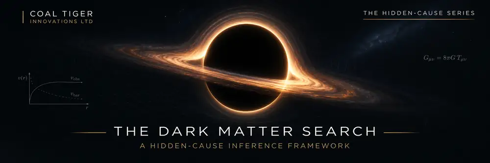

<p align="center">
  <a href="https://github.com/BlackRonin-coder/hidden-cause-scaling"></a>
</p>

<div align="center">

# HIDDEN CAUSES

### Reading what cannot be seen through what can be measured

**A public research perspective on residuals, uncertainty and falsifiable inference**

**LEON MAURICE BROWNE** · Independent systems research · Coal Tiger Innovations

[Research overview](docs/RESEARCH_OVERVIEW.md) &nbsp;·&nbsp; [Scientific boundaries](docs/SCIENTIFIC_BOUNDARIES.md) &nbsp;·&nbsp; [Synthetic demonstration](examples/README.md) &nbsp;·&nbsp; [References](docs/REFERENCES.md)

**NEW · 3 NOVEMBER 2026:** [Scientific progress — observational controls, model limitations and independent-review requirements](docs/RESEARCH_PROGRESS_2026_11_03.md)

**EXPLORATORY RESEARCH** &nbsp;|&nbsp; **PUBLIC OVERVIEW** &nbsp;|&nbsp; **NOT EXPERIMENTAL CONFIRMATION**

*The event-horizon artwork is an artistic illustration, not a numerical black-hole simulation or evidence of dark matter.*

</div>

---

## The question

> **When the source of a phenomenon is hidden, what can its measurable consequences tell us—and how do we avoid mistaking an unexplained signal for proof of our preferred explanation?**

I began from a comparison between different forms of indirect observation. We infer distant planets from their effects on light or stellar motion, investigate material structure through diffraction, and study astrophysical systems through dynamical and gravitational measurements.

This repository presents a **public-facing perspective** on a wider hidden-cause research programme, including questions motivated by dark-matter searches. The central emphasis is not on claiming to have detected something new. It is on **how to ask a difficult question rigorously**.

## A disciplined research loop

| 01 · Model | 02 · Measure | 03 · Challenge | 04 · Predict |
|:---|:---|:---|:---|
| Establish what known mechanisms predict. | Locate structured differences between observation and prediction. | Audit noise, bias, model error and competing explanations. | State in advance what independent observations should show. |

```text
EXPECTED BEHAVIOUR          MEASURED BEHAVIOUR
       \                       /
        \                     /
         └── OBSERVED DIFFERENCE
                    │
           Background / bias?
                    │
       Repeatable and independent?
                    │
         Competing explanations?
                    │
          Prediction on new data
                    │
     RETAIN · REVISE · REJECT
```

A residual is **a question that deserves testing**, not automatically evidence for a new particle, field or theory.

## What this repository offers

| Included | What it demonstrates | Evidence status |
|---|---|---|
| **[Public research overview](docs/RESEARCH_OVERVIEW.md)** | The observable-effects framing, the research sequence and cross-domain context | Conceptual research perspective |
| **[Scientific boundaries](docs/SCIENTIFIC_BOUNDARIES.md)** | Claim limits, alternatives, falsification and what would count as progress | Explicit limitations; no discovery claim |
| **[Synthetic residual example](examples/README.md)** | Reproducible, deliberately simple baseline-versus-observation comparison | Illustrative data only; not astrophysical analysis |
| **[Reading and references](docs/REFERENCES.md)** | Pointers to established astronomy, detection and scientific-method resources | External sources; not endorsements |

## Why dark matter is part of the motivation

Dark matter is inferred through gravitational evidence, while its microscopic nature remains unsettled. That makes it an instructive example of the difference between **evidence that an explanation is needed** and **proof of a particular physical mechanism**.

This repository does not reproduce a complete dark-matter detection model. Its contribution here is the *research discipline*: question the baseline, quantify uncertainty, investigate competing causes and demand predictions that could fail.

## A reproducible miniature

The included Python demonstration uses **invented data** with a known baseline, bounded noise and deliberately inserted repeated effects. It shows what a residual looks like, including why a repeated pattern can be worth investigating without proving what caused it.

```bash
python3 examples/synthetic_residual.py
python3 -m unittest discover -s tests -v
```

The example uses only the Python standard library. It does not implement a detector, infer dark-matter parameters or reproduce the unpublished research machinery.

## Where this work stands

**November 2026 update:** The wider private research programme now includes source-pinned observational stress tests, covariance and competing-model diagnostics, and a technical review protocol. These are **not** published full-theory validation results. [Read the public scientific progress note](docs/RESEARCH_PROGRESS_2026_11_03.md).

- **Research status:** Exploratory; public conceptual presentation.
- **Independent physics validation:** Not established.
- **Dark-matter particle detection:** Not claimed.
- **Quantum-gravity confirmation:** Not claimed.
- **Code status:** An independently checkable teaching example, not a scientific inference package.
- **Review welcome:** Criticism, alternative explanations, experimental design and related literature.

For a fuller statement of what is—and is not—being claimed, see **[Scientific boundaries](docs/SCIENTIFIC_BOUNDARIES.md)**.

---

## About the author

**Leon Maurice Browne** is a systems engineer and founder of **Coal Tiger Innovations**, with a background in safety-critical railway signalling and independent engineering research. His interest in this problem comes from systems reasoning: when a complex system behaves unexpectedly, distinguish the observed difference from the proposed cause.

[GitHub profile](https://github.com/BlackRonin-coder) · [Coal Tiger](https://www.coaltigerltd.com/) · [LinkedIn](https://uk.linkedin.com/in/leon-maurice-browne-6438a71b0)

<sub>© 2026 Leon Maurice Browne. Research perspectives and a synthetic teaching example are provided for examination. No general reuse licence is granted; see <a href="RIGHTS.md">rights and permissions</a>. This repository contains intentionally limited public material.</sub>
